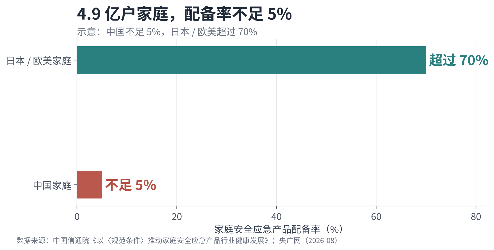
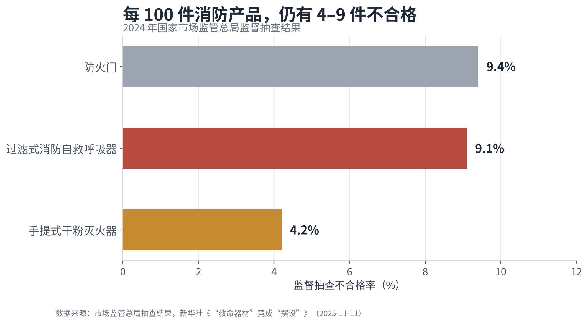
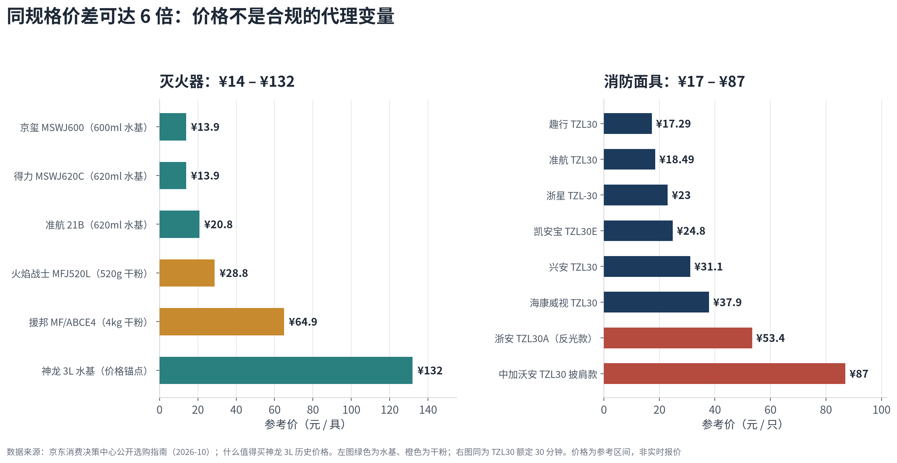
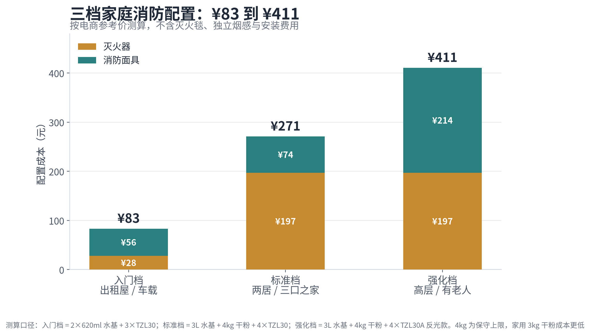

# 家用灭火器与消防面具品牌选购研究报告

## 摘要

家用消防器材的选购，本质上不是"挑一个最有名的牌子"，而是完成一次**合规筛选**：先确认产品是否在强制性认证与现行国标之内，再确认品牌的"品牌×品类"组合是否具备家用产品的官方背书，最后才比较价格、容量与使用体验。基于2025年12月工业和信息化部第36号公告、GB 4351-2023、GB 21976.7-2012以及2024—2026年市场监管抽查数据，本报告得出以下结论。

**第一，品牌选择的分水岭是"公告覆盖"，不是广告声量。** 工信部《家庭安全应急重点产品行业规范条件（2025版）》公告了9家家用灭火器企业和3家过滤式消防自救呼吸器企业，其中湖北江荆是唯一同时覆盖简易式水基、简易式干粉、3L以下手提水基、3kg以下手提干粉和自救呼吸器的"全满贯"企业；浙江浙安（星浙安）覆盖干粉与呼吸器；宇安消防是呼吸器专业厂。大量在"2026十大品牌"软文中高频出现的名字，并不在这份名单里。

**第二，灭火器的最优解是"1具3L水基 + 1具3kg/4kg干粉"，而不是一堆620ml小瓶。** 3L水基负责厨房、客厅、电器初火，清洁、抗复燃；干粉负责阳台、车库、疏散通道的兜底，便宜、温域宽、寿命长。620ml车载小瓶喷射时间通常只有约5秒，只适合车内和床头的第一时间处置。

**第三，消防面具只买TZL30，并按"家庭人数+1"配置。** TZL30的30分钟是额定防护上限，不是"戴上就能呼吸30分钟"；产品有效期一般为3年，拆封即失效，且不能供氧、不能用于缺氧密闭空间。品牌上优先江荆、星浙安、宇安；预算有限可选趣行、准航等入门款，但必须逐只核对CCC与S码。

**第四，一套覆盖三口之家的标准配置约需270元。** 按电商参考价测算，入门档约83元、标准档约271元、强化档约411元，不含灭火毯与独立烟感。相对于火灾中"80%以上伤亡源于烟气"的后果，这是一笔极低成本的保险。

> 一句话结论：灭火器买江荆、欧伦泰、水力、楼山（龙雹）、振兴的3L水基与3kg干粉；面具买江荆、星浙安、宇安的TZL30；认准CCC与S码，按人头+1，三年一换。

## 1. 研究背景与范围

### 1.1 低配备率与高不合格率并存

中国家庭消防市场存在一个刺眼的反差：一方面，需求端几乎空白；另一方面，供给端的合格率并不让人放心。

需求端，我国有**4.9亿户家庭**，但家庭安全应急产品配备率**不足5%**，而日本、欧美家庭超过70%。2025年，全国接报火灾**84.1万起**，死亡**1,827人**，直接财产损失**85.3亿元**；起数与死亡人数同比分别下降7.6%和9.5%，但总量仍然庞大。更值得关注的是结构：2024年高层建筑火灾**3.6万起**，只占火灾总数的5.4%，死亡人数却占**15%以上**。高层住宅"蔓延快、疏散难"的特征，使家庭层面的早期处置与逃生装备变得比公共场所更重要。

供给端，2024年国家市场监管总局对三类消防产品的监督抽查显示：防火门不合格率9.4%，过滤式消防自救呼吸器9.1%，手提式干粉灭火器4.2%。2025年的联合专项整治关停网络销售链接**2,400余条**，下架问题产品**2,793批次**，检查生产、销售、使用单位**6.24万家**（[新华社调查](http://www.ce.cn/cysc/newmain/yc/jsxw/202511/t20251111_2571152.shtml)）。这意味着，消费者即使产生了购买意愿，也面临"买错"的高概率风险。

数据背后的质量问题具有明确的物理指向。ABC干粉灭火剂的第一主要组分应为磷酸二氢铵，含量要求为75%；但抽检中发现有产品仅**43.8%**，个别产品被掺入滑石粉等廉价填充物。过滤式自救呼吸器要求一氧化碳透过浓度的时间加权平均值不大于**200 mL/m³**，但有不合格产品超过**1,000 mL/m³**，原因正是CO催化触媒被替换成了干燥剂等非触媒材料。2022年宁波一起造成7人遇难的火灾中，涉事灭火器的灭火剂有效含量只有**20%**。这些不是"参数好看不好看"的问题，而是"关键时刻能不能活下来"的问题。**家庭消防消费的第一个决策，不是品牌偏好，而是排除不合格品。**

### 1.2 研究范围与方法

本报告聚焦两类家庭高频产品：**手提式/简易式灭火器**（水基型、ABC干粉型）与**过滤式消防自救呼吸器**（俗称消防面具、防烟面罩、逃生面罩）。评估维度包括五项：合规资质（CCC、S码、现行国标）、产品性能（灭火级别、喷射时间、滤烟效率等）、家用适配（容量、重量、低温、清洁性）、服务能力（维保网点、可充装性）、价格与渠道。

数据来源以官方文件与公开标准为主：工信部2025年第36号公告及附件名单、GB 4351-2023、GB 21976.7-2012、市场监管总局抽查通报、应急管理部科普材料、江苏省2025年消防产品省级抽查通报，辅以京东消费决策中心2026年10月公开的型号与参考价，以及CNPP、买购网等品牌资料。需要说明两点局限：其一，电商价格为参考价，随促销与SKU变化；其二，本报告未进行实验室实测，性能判断以标准要求与企业公开标识为依据，消费者购买时仍应逐只核验证书与S码。

## 2. 品类选择：先选对类型，再谈品牌

### 2.1 灭火器：水基与干粉不是"二选一"，而是"分层配置"

家用灭火器的核心变量不是容量，而是**灭火级别覆盖的火种**。A类为固体（木材、纸张、织物），B类为液体（油、汽油），C类为气体，E类为带电设备，F类为烹饪油脂。GB 4351-2023于2023年12月28日发布、2025年1月1日实施，整合了旧版三项标准，并新增D类（金属火灾）和F类（烹饪火灾）的分类执行要求，同时更改了电绝缘性能、阀门和压力指示器的要求。换句话说，2025年1月1日之后新生产的灭火器，应执行GB 4351-2023，而不是旧标。

| 类型 | 典型规格 | 覆盖火种 | 优势 | 局限 | 建议点位 |
|---|---|---|---|---|---|
| 水基型（水雾/泡沫） | 3L 手提，MS/ABEF3 | A/B/E/F，以标识为准 | 无粉尘、抗复燃、可清洁、可灭带电火（有E类标识时） | 报废6年；普通款0℃以下可能结冰 | 厨房门口、客厅、玄关 |
| ABC干粉 | 3kg/4kg 手提，MF/ABCE | A/B/C/E | 价格低、-20℃~60℃、报废10年 | 粉尘腐蚀、易复燃、浓烟中遮挡视线 | 阳台、车库、疏散通道 |
| 简易式水基 | 620ml，13B/21B | B/E，部分含A/F | 体积小、随手可取、无粉尘 | 喷射约5秒，仅限初期小火 | 车内、卧室床头 |
| 二氧化碳 | 2kg/3kg | B/E | 无残留、适合精密设备 | 价格高、密闭空间缺氧风险、报废12年 | 家庭一般不需要 |
| 气溶胶 | 便携式 | 视产品标识 | 极小、无压、免维护 | 品牌分散、需逐款核证 | 仅作补充，不作主力 |

一个常见误区是"水基不能灭电火"。带电火能否扑救，取决于产品是否标注E类或电绝缘性能，与"水基/干粉"的品类标签无关；反过来，干粉也不是万能，锂电池热失控、精密电子设备、厨房油锅都不是普通干粉的最佳场景。厨房油锅起火的第一选择是**灭火毯**（盖灭、隔绝氧气），第二选择是标注F类的水基灭火器，绝不能用水柱直接冲击。另一个误区是"容量越大越好"：4kg干粉瓶体约14×14×50cm，体积和重量都明显大于620ml小瓶，老人单手难提；620ml小瓶虽然轻，但部分型号标称喷射时间仅≥5秒，不足以处置已经蔓延的火。正确的顺序是**先定点位、再定容量、最后定类型**。

从家庭配置的角度看，水基与干粉的关系不是替代，而是分工。3L水基的药剂可以渗透木材、织物，降温与隔氧同时发生，灭火后清水擦拭即可，适合厨房、客厅、卧室这些"烧起来会心疼家具"的场景；干粉的优势是单位成本最低、温域最宽、寿命最长，适合阳台、车库、楼道这些"只求压住、不怕脏"的场景。两者合计的覆盖范围，远大于同价位的一堆小瓶。**因此，家庭灭火器的正确组合是"1具3L水基 + 1具3kg/4kg干粉"，而不是在每个房间摆一个620ml小瓶。** 这一组合的另一个好处是，它把"能不能灭"与"敢不敢用"分开了：水基给老人、孩子更低的心理门槛，干粉给成年人在疏散通道上一个更强的兜底。对于90平方米左右的两居室，这套组合足以覆盖绝大多数初起火灾；对于有电动车、燃气热水器或地下车库的家庭，再增加一具干粉或锂电池专用装置即可。

### 2.2 消防面具：只买TZL30，且只买"能查到S码"的

过滤式消防自救呼吸器的型号命名有明确含义：T表示逃生避难器材，Z表示自救呼吸器，L表示过滤式，后面的数字是额定防护时间（分钟）。**TZL30就是30分钟防护，TZL15/20/25分别是15/20/25分钟。** 对于高层住宅，从家门口走到楼梯间、再下到安全层，30分钟是更稳妥的冗余；15分钟款只适合低层或极短距离撤离，不建议作为家庭主力。

GB 21976.7-2012对产品提出了可核验的硬指标：滤烟效率不小于95%，视窗透光率不小于85%，总视野不小于70%、双目视野不小于55%、下方视野不小于35%，佩戴质量不大于1000克，防护头罩应有环绕头部一周的反光标志或采用反光材料。产品有效期一般为**3年**，且为**一次性**使用，拆封即失效。更重要的是，过滤式呼吸器靠滤毒罐"过滤"而不是"制氧"，**不能用于缺氧的密闭空间，也不能替代工业防毒面具**。

| 核验项 | 国标/规则要求 | 消费者怎么看 |
|---|---|---|
| 强制认证 | CCC认证 + 消防产品身份标识（S码） | 包装有3C标志，S码可在cccf.net.cn或cx.cnca.cn查询 |
| 执行标准 | GB 21976.7-2012 | 包装或本体印有标准号 |
| 型号 | TZL30（30分钟） | 型号中的"30"即额定防护时间 |
| 滤烟效率 | ≥95% | 看检测报告或产品标识 |
| 透光率 | ≥85% | 视窗清晰，能看清6米外扑克牌大小的字 |
| 视野 | 总视野≥70%、双目≥55%、下方≥35% | 结构设计，试戴确认 |
| 佩戴质量 | ≤1000克 | 手感轻，老人儿童能托住 |
| 反光标志 | 环绕头部一周或反光材料 | 关灯用手电照，能看到反光 |
| 有效期 | 一般3年 | 包装上的生产日期与有效期 |
| 使用限制 | 一次性、仅逃生、不供氧 | 包装警示语"仅供一次逃生使用" |

使用层面的细节同样决定成败。第一，**按"家庭人数+1"配置**，三口之家至少4只，分别放在卧室床头、客厅沙发旁、玄关和厨房门口，而不是全部塞在一个柜子里。第二，**买回来要试戴一次**，确认头带能拉紧、视窗不压眼镜、老人能在30秒内戴好；很多产品成人款儿童戴不住，儿童应单独购买儿童款。第三，**不要买"临期款"**。面具的3年有效期从生产日期起算，不是从购买日期起算；电商大促中的低价款，有可能是库存尾货。第四，**不要相信"防毒面具"四个字**。工业防毒面具的滤毒盒针对特定化学气体，不能过滤火场一氧化碳；防尘口罩、湿毛巾同样不能。**在火场里，只有带CO催化触媒层的过滤式自救呼吸器，才能为你争取那30分钟。**

## 3. 品牌格局：把"排行榜"换成"白名单"

### 3.1 供给端的真实结构：9+3

2025年12月2日，工业和信息化部发布[2025年第36号公告](https://www.miit.gov.cn/zwgk/zcwj/wjfb/gg/art/2025/art_c950ddd0e65b478bb6d990dd75baaff9.html)，公布了符合《家庭安全应急重点产品行业规范条件（2025版）》的企业名单：**家用灭火器生产企业9家，过滤式消防自救呼吸器生产企业3家**。这份名单的筛选程序包括企业自主申报、省级工信主管部门核实推荐、专家评审、产品抽检、征求相关单位意见和网上公示，不是简单的"报名即入"。更关键的是，它把"家用"限定在具体品类：灭火器包括简易式灭火器、3kg以下手提式干粉灭火器、3L以下手提式水基型灭火器；呼吸器即过滤式消防自救呼吸器。**这意味着"品牌在名单里"不等于"该品牌所有产品都在名单里"，必须看"品牌×品类"的组合。**

| 企业 | 地区 | 品牌 | 灭火器公告品类 | 呼吸器 |
|---|---|---|---|---|
| 湖北江荆消防科技股份有限公司 | 湖北 | 江荆、楚江荆 | 简易水基、简易干粉、3L以下水基、3kg以下干粉 | ✓ |
| 浙江浙安消防设备有限公司 | 浙江 | 星浙安 | 3kg以下干粉 | ✓ |
| 北京久久神龙消防器材有限公司 | 北京 | 神龙 | 简易水基、简易干粉、3kg以下干粉 | — |
| 浙江欧伦泰防火设备有限公司 | 浙江 | 欧伦泰 | 简易水基、简易干粉、3L以下水基、3kg以下干粉 | — |
| 水力消防科技有限公司 | 福建 | 水力牌 | 简易水基、3L以下水基、3kg以下干粉 | — |
| 泉州市山河消防技术有限公司 | 福建 | 天广 | 3kg以下干粉 | — |
| 百安消防科技有限公司 | 福建 | 百安 | 3kg以下干粉 | — |
| 青岛楼山消防器材厂有限公司 | 山东 | 龙雹 | 3L以下水基、3kg以下干粉 | — |
| 广东振兴消防设备有限公司 | 广东 | 振兴 | 3L以下水基、3kg以下干粉 | — |
| 浙江宇安消防装备有限公司 | 浙江 | 宇安消防 | — | ✓ |

注：9家灭火器企业与3家呼吸器企业中有2家重叠（江荆、星浙安），去重后共10家企业。

这张表透露出两个容易被忽略的事实。第一，**江荆是唯一的"全满贯"**：四类家用灭火器全部覆盖，同时还有呼吸器；欧伦泰是灭火器"四类全满贯"但没有呼吸器；星浙安是"干粉+呼吸器"的双品类组合。第二，**许多在电商和软文中声量很大的品牌，并不在名单里**。这不一定意味着产品不合格——公告采取企业自愿申请，未申请不等于被否定——但对于普通家庭，"有官方公告背书"显然比"广告投得多"更可核验。行业结构也解释了为什么品牌集中度低：据中国信通院披露，全国简易式与手提式灭火器、过滤式自救呼吸器、家用可燃气体探测器的生产企业中，**超过八成是小微企业**，缺乏龙头品牌，质量稳定性参差不齐。**在一个"小散弱"的行业里，白名单比品牌知名度更接近事实。**

### 3.2 五级品牌梯队：从"全满贯"到"不建议"

把"合规背书"与"家用适配"放在一起，可以把市面上的品牌分成五级。需要强调：梯队不是"好坏"的绝对排序，而是"家庭购买时的决策优先级"；T2的传统工程大厂并非不合格，只是其家用产品线的官方背书与SKU丰富度弱于T0/T1。

| 梯队 | 判定标准 | 代表品牌 | 购买结论 |
|---|---|---|---|
| T0 全满贯 | 灭火器四类全覆 + 呼吸器 | 江荆 | 全屋一站式首选 |
| T0 双品类 | 灭火器公告 + 呼吸器 | 星浙安 | 干粉+面具首选 |
| T1 灭火器全品类 | 四类家用灭火器全覆 | 欧伦泰 | 水基/干粉均衡，出口型 |
| T1 家用灭火器公告 | 覆盖部分家用灭火器品类 | 神龙、水力、楼山（龙雹）、振兴、天广、百安 | 按具体品类选 |
| T1 呼吸器公告 | 呼吸器专业企业 | 宇安 | 面具专业厂 |
| T2 传统工程大厂 | 3C齐全，但未入家用公告 | 龙成、海天、淮海、桂安、川消、威能 | 干粉可买，水基与面具不作为首选 |
| T3 电商/跨界 | 3C可查，需核对证书主体 | 海康威视、得力、火焰战士、援邦、趣行、准航、京玺 | 入门/补充，逐款核证 |
| T4 白牌/软文品牌 | 无CCC、无S码、无生产日期 | 大量"厂家直销""酒店款""盲盒" | 不建议 |

T3与T4的区别，不在于价格高低，而在于**证书主体是否可追溯**。海康威视、得力等跨界品牌有明确的公司主体和售后体系，产品即使由外部工厂生产，证书与S码仍可追责；而T4的白牌产品往往连生产日期都没有，出了问题找不到主体。2026年出现的部分以"2026家用消防选购攻略""民用消防品牌前五"为标题的文章，实质是商业软文：其中不少文章共同推荐某个固定品牌，用"实测""专利""3C全覆盖"等无法核验的表述制造权威感，却极少给出证书编号或检测报告编号。**判断一篇测评是否可信，最简单的标准是：它有没有告诉你"去哪里查"，而不是只告诉你"买哪个"。**

另一个值得警惕的现象是"同规格价差悬殊"：同一规格的TZL30，电商价从17元到99元不等，价差接近6倍；同为灭火器，620ml水基从13.9元到20.8元，3L水基可到132元。价格差异的一部分来自材质（硅胶vs橡胶、铝瓶vs碳钢）、款式（是否披肩、是否反光）和品牌溢价，另一部分则来自"是否偷了滤毒罐里的触媒、是否少装了干粉"。在无法现场检测的情况下，**"低于合理成本"与"高于合理溢价"都不是好信号**：前者可能是偷工减料，后者可能是营销税。合理的做法是回到证书、S码与检测报告，而不是在价格两端做猜测。

## 4. 灭火器品牌评估与推荐

### 4.1 评估维度与价格带

对家庭用户而言，灭火器的评估可以简化为五个问题：**有没有CCC、执行的是不是GB 4351-2023、灭火级别覆盖哪些火种、瓶体与阀门是否可靠、坏了有没有地方修。** 前两个是底线，第三个决定"能不能灭对火"，第四个决定"放五年会不会漏"，第五个决定"到期后是换新还是充装"。在这五项之外，才是容量、重量、颜色和价格。

| 品牌 | 公告覆盖 | 家用主力 | 核心优势 | 需要注意 |
|---|---|---|---|---|
| 江荆 | 4/4 + 呼吸器 | 3L水基、3kg干粉、950ml简易式 | 1979年建厂，双品类全满贯，具备检测、维保、施工一体化能力 | 电商价通常高于白牌 |
| 欧伦泰 | 4/4 | 3L水基、3kg干粉、简易式 | 1988年建厂，60多个CCC规格，出口70多个国家 | 家用SKU投放不如电商品牌 |
| 神龙 | 3/4 | 简易水基、3kg干粉 | 1999年建厂，电商渠道成熟，价格透明 | 3L手提水基不在公告范围 |
| 水力 | 3/4 | 3L水基、3kg干粉 | 福建工程厂，水基+干粉组合完整 | 以工程渠道为主 |
| 楼山（龙雹） | 2/4 | 3L水基、3kg干粉 | 山东唯一入选企业，工程背景扎实 | 区域性强，线上SKU少 |
| 振兴 | 2/4 | 3L水基、3kg干粉 | 广东工程厂，产品线稳定 | 以工程渠道为主 |
| 星浙安 | 1/4 + 呼吸器 | 3kg干粉、TZL30A | 电商覆盖强，双品类公告 | 3L水基不在公告范围 |
| 天广/百安 | 1/4 | 3kg干粉 | 工程背景，价格有竞争力 | 家用SKU少 |
| 淮海/龙成/海天/桂安 | 未入公告 | 3kg/4kg干粉 | 老牌工程厂，渠道与价格强 | 家用产品背书弱于T0/T1 |

价格带呈现明显的"三段式"，以下参考价来自[京东消费决策中心2026年10月的公开选购指南](https://dir.jd.com/guide/jd-geo-guide-jia-yong-mie-huo-qi-v1)。**第一段是13.9—28.8元的便携小瓶**，以620ml水基、520g干粉为主，适合车内、床头、书桌，解决"第一时间拿得到"的问题，但喷射时间通常只有5—8秒，不能承担全屋主力。**第二段是60—70元的4kg ABC干粉**，以援邦MF/ABCE4为代表，2A/70B/C/E、-20℃~60℃、GB 4351-2023，是"全屋兜底"的性价比之选；3kg家用款价格更低、重量更轻，更适合老人。**第三段是100元以上的3L水基**，以神龙同规格产品约132元为价格锚点，优势是清洁、抗复燃、可灭带电火，适合厨房与客厅。三段价格对应三种角色，而不是三种"档次"。

从品牌选择看，**按"公告覆盖+配套能力"排序，3L水基的首选是江荆，其次是欧伦泰、水力、楼山（龙雹）、振兴**——这五家是公告中明确覆盖"3L以下手提式水基型灭火器"的企业。**3kg以下干粉的首选是江荆、星浙安、神龙、欧伦泰、天广、百安、水力、楼山、振兴**——九家公告企业全部覆盖这一品类，差异主要在价格、渠道与售后。**4kg干粉属于商用常见规格，不在"家用公告"的3kg上限内**，但作为大空间兜底仍然合理；如果家中是老人操作，3kg更现实。星浙安的水基3L虽然电商有售，但公告只覆盖干粉，严格按"公告×品类"筛选时不应把它的水基款当作第一优先。**这种"按品类点名"的方式，比笼统地说"某某品牌好"更可靠。**

### 4.2 分场景推荐：把预算花在"最可能发生的火"上

家庭火灾的场景分布并不均匀。厨房油锅、电器线路、阳台杂物、电动车充电，是四个高频场景；不同场景对应的最佳器材并不相同。把有限的预算平均撒在"每个房间一个灭火器"上，不如按场景配置"一个主力+一个兜底+一人一只面具"。

| 场景 | 首选 | 备选 | 关键说明 |
|---|---|---|---|
| 厨房 | 3L水基（标F/E）+ 灭火毯 | 2L水基 | 油锅火先盖毯，再喷雾；禁止水柱直冲 |
| 客厅/卧室 | 3L水基 | 2kg干粉 | 清洁、可灭电器；放在门口而非沙发后 |
| 玄关/阳台/车库 | 3kg或4kg ABC干粉 | 3L水基 | 干粉兜底，注意粉尘与复燃 |
| 车内 | 620ml 21B水基 | 520g干粉 | 5秒级喷射，仅限初期小火 |
| 电动车/充电区 | 锂电池专用装置或3L水基 | — | 普通干粉可能压不住热失控复燃 |
| 高层住宅 | 3L水基 + TZL30×N | 灭火毯 | 先逃生、后灭火；面具按人头+1 |

具体到品牌，厨房与客厅的3L水基优先**江荆**（全满贯、具备维保能力），其次**欧伦泰**（出口型、规格全）；如果所在城市买不到这两家，**水力、楼山（龙雹）、振兴**的3L水基同样在公告范围内，可以作为区域替代。玄关与阳台的3kg干粉，**江荆、星浙安、神龙**的电商可得性最好；4kg干粉可以看**淮海、龙成、海天**等工程老牌，价格低、渠道广，但要接受"家用公告未覆盖"这一事实。车内小瓶不必追求"大牌"，**准航21B（约20.8元）、得力MSWJ620C（约13.9元）、火焰战士MFJ520L（约28.8元）**都属于"够用、可替换"的入门选择，关键是每12个月检查一次瓶体与压力。

值得单独说明的是"电动车/锂电池"场景。普通ABC干粉对锂电池热失控的降温与抗复燃能力有限，明火扑灭后电池仍可能复燃；如果家中有电动车入户充电、地下车库充电桩，优先配置**锂电池专用灭火装置**或大容量水基，并把"不在室内充电"作为第一道防线。灭火器是最后的手段，不是违规充电的许可证。**场景化配置的本质，是把"最可能发生的火"与"最顺手的器材"匹配起来；脱离场景谈品牌，和脱离剂量谈毒性一样没有意义。**

## 5. 消防面具品牌评估与推荐

### 5.1 国标硬指标与价格带

消防面具的评估比灭火器更简单，也更残酷：它没有"部分有效"的中间状态，滤毒罐里的触媒层要么有、要么没有；面具的密封要么贴合、要么漏烟。消费者无法拆开滤毒罐检测，但可以通过"证书—S码—标识—有效期"四步，把绝大多数不合格品排除在外。

第一步是**CCC认证**。过滤式消防自救呼吸器属于强制性认证的消防产品，应具备强制性认证证书及对应的型式试验报告，施加3C标志和消防产品身份标识。第二步是**S码**。每件出厂产品带有一枚身份信息标志，14位明码与二维码可查规格型号、生产日期、生产批号和流向；查不到或对不上，就要打问号。第三步是**标识**。包装上应有GB 21976.7-2012、型号TZL30、生产日期、有效期、"本产品仅供一次逃生使用，不能用于工作保护"等字样。第四步是**有效期**。一般为3年，且从生产日期起算；拆封即失效，不能"看起来没坏"就继续用。

价格方面，TZL30的电商价从17.29元到99元不等。价差主要来自：面罩材质（硅胶vs橡胶）、款式（头罩式vs披肩式）、是否带反光条、包装（硬盒vs软袋）、品牌溢价。**同为TZL30、同为30分钟额定防护，贵出来的钱并不买"更长的防护时间"，而是买贴合度、视野、佩戴便利和心理安慰。** 对普通家庭，20—40元区间的合规产品已经能满足"从家门口走到安全层"的需求；50元以上的反光款、披肩款，适合高层、楼道照明差、有老人的家庭。

需要纠正一个流传很广的说法："30元以下的面罩都是假货。"从京东公开在售的入门款看，趣行TZL30约17.29元、准航TZL30约18.49元、浙星TZL-30约23元，均标注TZL30型号，其中前两款在商品页明确标注3C。价格低不等于一定不合格，价格高也不等于一定合格；**唯一可靠的判断是证书与S码，而不是价格**。反过来，某些售价87—99元的披肩款，在软文中被描述为"高端""专利"，但其防护时长仍是30分钟，溢价主要来自款式与营销。消费者不必为"看起来更高级"支付过多。

### 5.2 品牌推荐排序：先看"公告"，再看"好买"

| 优先级 | 品牌/型号 | 依据 | 价格参考 | 适合人群 |
|---|---|---|---|---|
| 1 | 江荆 TZL30 | 呼吸器公告企业，灭火器全满贯，可同店配齐 | 以具体SKU为准 | 想一站式买齐灭火器与面具的家庭 |
| 2 | 浙安（星浙安）TZL30A | 双品类公告，反光条，电商覆盖好 | 约53.4元 | 高层、楼道照明差 |
| 3 | 宇安 TZL30A | 呼吸器公告企业，专业呼吸器厂，较早一批CCC | 以具体SKU为准 | 看重专业背景与工业级经验 |
| 4 | 海康威视 TZL30 | 3C，品牌背书，硅胶成人款 | 约37.9元 | 认品牌、预算中等 |
| 5 | 趣行/准航/浙星 TZL30 | 3C，入门价，适合多点位布置 | 约17.3—23元 | 出租屋、多房间、预算有限 |
| 不建议 | 无CCC/S码/生产日期、"酒店款"、盲盒 | 无法追溯，防护性能不可验证 | — | — |

江荆排在第一，不是因为它的面具一定比宇安好，而是因为**"可一站式配齐"本身就是家庭场景的优势**：同一品牌、同一渠道、同一套售后，减少"灭火器买了、面具忘了"的概率。浙安（星浙安）排在第二，是因为它的TZL30A带反光条，在高层断电、浓烟环境下的可见性更好，而且电商可得性强。宇安排在第三，是因为它是呼吸器公告企业中产品线更聚焦于呼吸防护的一家；如果消费者所在城市有宇安的线下经销，优先线下试戴。海康威视排第四，是"品牌背书+外部生产"的典型：证书主体需要核对，但售后与渠道比白牌可靠，适合不想研究参数的消费者。入门款排第五，不是"差"，而是"够用"：在确认CCC与S码的前提下，17—23元的TZL30完全可以作为多点位配置。

真正需要避免的是"三类货"：**第一类是无CCC、无S码、无生产日期的"三无"产品**；**第二类是所谓"酒店款""工程款"**——业内已有商家坦言"酒店款是应付消防检查用的"，性能往往低于家用款；**第三类是电商"盲盒"**——不同品牌混装、检测报告来源不明。这些产品的共同特征是"便宜得没有道理"或"信息少得没有道理"。在面具这个品类上，**"不确定"本身就是风险**：你不知道滤毒罐里有没有催化触媒，就等于把火灾中最主要的致死风险留给了运气。**买面具不是买安慰剂，而是买一个能在30分钟内把CO浓度压在200 mL/m³以下的正品。**

## 6. 家庭配置方案与成本测算

### 6.1 三档配置：从"有"到"够用"到"稳妥"

把前述品类与品牌结论落到一套可执行的清单，可以分成三档。三档的差异不在"品牌档次"，而在**覆盖场景的数量**与**面具的配置密度**。以下成本按2026年10月电商参考价测算，不含灭火毯、独立烟感与安装费用；4kg干粉为保守上限，家用3kg干粉成本更低。

| 档位 | 灭火器 | 面具 | 测算成本 | 适用 |
|---|---|---|---|---|
| 入门档 | 2×620ml水基（约27.8元） | 3×TZL30（约55.5元） | 约83元 | 出租屋、单间、车载补充 |
| 标准档 | 3L水基（约132元）+ 4kg干粉（约64.9元） | 4×TZL30（约74元） | 约271元 | 两居/三口之家 |
| 强化档 | 3L水基（约132元）+ 4kg干粉（约64.9元） | 4×TZL30A反光款（约213.6元） | 约411元 | 高层、有老人/儿童 |

标准档是多数家庭的"甜点"。3L水基放在厨房门口或玄关，4kg干粉放在阳台或疏散通道，4只面具分别放在主卧床头、次卧/儿童房、玄关和厨房门口，对应三口之家"3+1"的配置口径；如果常住人口更多，按"人数+1"递增。强化档把面具换成带反光条的TZL30A，仍按4只配置，适合住在10层以上、楼道可能断电、家中有行动不便老人的家庭。入门档适合租房或预算极紧的情况，但它只能覆盖"一间房+一次初起火灾"，不能替代标准档。

还有两项"低成本高回报"的补充，虽然不在本报告的价格测算内，但应当优先于"买更贵的灭火器"：**一是灭火毯**，1.5m×1.5m的硅胶灭火毯约几十元，是厨房油锅火最有效、最不脏的手段；**二是独立式烟感**，几十元一只，能在睡眠中提前报警，把"逃生窗口"从几分钟拉长到十几分钟。消防投入的边际收益，在"预警"和"隔烟"上远高于"更大容量的灭火器"。**如果预算只有300元，一个可参考的顺序是：烟感 > 面具 > 灭火毯 > 水基灭火器 > 干粉灭火器；如果预算有500元，再补齐干粉与备用面具。**

### 6.2 点位与数量：比"买什么"更容易被忽略

器材的可用性，取决于它在哪里。灭火器应放在**出口附近、疏散路径上、随手可取**的位置，而不是厨房灶台正上方（起火时够不到）、阳台角落（被杂物挡住）或锁在柜子里。水基灭火器建议放在厨房门口或玄关，干粉放在阳台门内侧或楼道出口；面具建议"一人一只、分散存放"，主卧床头、儿童房书桌、玄关鞋柜各一只，避免"全家人的面具都在客厅柜子里，而火在客厅"。

数量上，普通两居室配置2具灭火器即可，按"厨房门口/玄关1具水基 + 阳台门内侧或楼道出口1具干粉"布置；大面积住宅或有老人、儿童的家庭可增加到3具。面具按"常住人口+1"配置，并每半年检查一次包装是否鼓袋、是否受潮、是否过期。**不要把所有器材集中在一个"消防箱"里**：消防箱适合商铺验收，不适合家庭逃生；家庭需要的是"每个可能被困的房间，都有一只够得着的面具"。

## 7. 购买与使用避坑

### 7.1 三步验真：证书、S码、标识

| 步骤 | 操作 | 判定标准 |
|---|---|---|
| 查证书 | 登录cccf.net.cn或cx.cnca.cn，输入企业名称/型号 | 证书在有效期内，证书上的名称、规格型号与实物一致 |
| 扫S码 | 扫描包装或本体的14位明码/二维码 | 规格、生产日期、生产批号、流向与实物一致 |
| 看标识 | 检查标准号、生产日期、有效期、灭火级别、使用温度 | 灭火器为GB 4351-2023；面具为GB 21976.7-2012；均在有效期内 |

三步中最容易出错的是"证书是真的，但型号对不上"。消防产品证书按型号发放，同一品牌的不同规格可能对应不同证书；商家展示一张"某型号"的证书，不代表你买的这个型号也在证书范围内。**正确做法是把实物铭牌上的型号、规格、生产日期与证书逐字核对**，而不是只看"有3C"三个字。另一个细节是S码：A签贴在产品本体，B签附在合格证明文件里，两联齐全才算完整；只有包装盒上一个图标、扫不出信息的，要谨慎。

### 7.2 生命周期：买回家只是开始

| 品类 | 首次维修 | 后续维修 | 强制报废 | 日常检查 |
|---|---|---|---|---|
| 水基型灭火器 | 出厂满3年 | 首次维修后每满1年 | 6年 | 每月看压力表是否在绿区、瓶体是否锈蚀 |
| 干粉灭火器 | 出厂满5年 | 首次维修后每满2年 | 10年 | 每月看压力表、铅封、喷管 |
| 二氧化碳灭火器 | 出厂满5年 | 首次维修后每满2年 | 12年 | 称重，年泄漏量不超过额定充装量的5% |
| 过滤式自救呼吸器 | — | — | 3年（有效期） | 包装完好、干燥避光、不拆封 |

这些年限来自XF 95-2015《灭火器维修》与GB 55036-2022《消防设施通用规范》（[天津市消防救援局答复](http://tj.119.gov.cn/glllm/zmljl/index_19980.html?id=4753846)）。需要区分"维修"与"报废"：维修是换药剂、充压、换密封件；报废是瓶体达到年限或出现严重锈蚀、凹坑、变形、机械损伤，必须停止使用。家用灭火器最容易犯的错是"买回来放到过期"：压力表指针掉到红区、药剂结块、喷管龟裂，真要用时喷不出来。**建议在手机日历里设两个提醒：每年11月9日（消防日）检查一次，购买满3年/5年时送检或更换。**

### 7.3 六个高频误区

| 误区 | 事实 |
|---|---|
| 湿毛巾、防尘口罩可以替代消防面具 | 不能过滤CO、HCN等有毒气体；火场中必须用带CO催化触媒的TZL30 |
| 过滤式面具可以供氧 | 不能；它靠过滤，不制造氧气，缺氧密闭空间禁用 |
| 干粉灭火器万能 | 锂电池热失控、精密设备、厨房油锅都不是最佳场景；干粉还会腐蚀家具家电 |
| 水基灭火器不能灭电火 | 能否灭带电火看是否标注E类/电绝缘性能，与"水基"品类无关 |
| 容量越大越好 | 先定点位再定容量；4kg干粉瓶体约14×14×50cm，老人难以单手提起 |
| 价格越贵越安全 | 同规格TZL30价差可达6倍；证书、型号、有效期比价格更重要 |

这六个误区背后是同一种心理：**用"看起来更贵、更大、更专业"来替代"是否合规、是否适用"的判断。** 消防器材的消费决策与普通家电不同，它的"使用时刻"可能只有一次，且无法试用；因此，购买时的核验成本，就是对冲使用时的失效风险。把证书查一遍、把S码扫一遍、把家里人叫来试戴一次，花不了半小时，却能排除大部分"关键时刻掉链子"的可能。

## 8. 结论

中国家用消防器材市场是一个"需求几乎空白、供给高度分散"的市场：4.9亿户家庭的配备率不足5%，而生产企业中超过八成是小微企业，2024年呼吸器国抽不合格率仍达9.1%。在这样的市场里，品牌的意义不是"面子"，而是"可追溯的责任主体"；选购的核心不是"哪个牌子最好"，而是"哪个品牌在哪个品类上通过了哪项合规要求"。

从这一标准出发，答案并不复杂。灭火器，3L水基优先江荆，其次欧伦泰、水力、楼山（龙雹）、振兴；3kg以下干粉在九家公告企业中按渠道与价格选择；4kg干粉作为大空间兜底，不必强求"家用公告"。消防面具，优先江荆、星浙安、宇安，预算有限可选趣行、准航等入门款，但必须逐只核对CCC与S码。三口之家的标准配置约270元，强化配置约411元，成本远低于一次火灾的损失。

真正决定这套配置是否有效的，不是购买那一刻的品牌选择，而是之后的三年：面具是否在有效期内、灭火器压力表是否在绿区、家里人是否戴过一次、是否知道最近的疏散楼梯在哪里。器材只是把"概率"往生的一侧推了一点，真正的安全来自"提前预警、及时逃离、不贪恋财物"的习惯。**在一个80%以上火灾伤亡源于烟气的现实里，最贵的不是灭火器，而是"以为买了就安全"的错觉。**

## 9. 参考文献

[1] 工业和信息化部. 中华人民共和国工业和信息化部公告2025年第36号[EB/OL]. (2025-12-02)[2026-11-13]. https://www.miit.gov.cn/zwgk/zcwj/wjfb/gg/art/2025/art_c950ddd0e65b478bb6d990dd75baaff9.html.

[2] 工业和信息化部. 符合《家庭安全应急重点产品行业规范条件（2025版）》企业名单[EB/OL]. (2025-12-02)[2026-11-13]. http://hunan.gov.cn/zqt/zcsd/202512/33862079/files/033eb1955ef94a27ae4638edb7c76be6.pdf.

[3] 国家市场监督管理总局, 国家标准化管理委员会. GB 4351-2023 手提式灭火器[S]. 北京: 中国标准出版社, 2023.

[4] 国家质量监督检验检疫总局, 中国国家标准化管理委员会. GB 21976.7-2012 建筑火灾逃生避难器材 第7部分: 过滤式消防自救呼吸器[S]. 北京: 中国标准出版社, 2012.

[5] 新华社. "救命器材"竟成"摆设" 不合格消防产品何以流入市场[EB/OL]. (2025-11-11)[2026-11-13]. http://www.ce.cn/cysc/newmain/yc/jsxw/202511/t20251111_2571152.shtml.

[6] 人民政协报. 一批消防领域强制性国家标准发布 三项变化值得关注[EB/OL]. (2026-11-12)[2026-11-13]. https://www.rmzxw.com.cn/c/2026-11-12/4006603.shtml.

[7] 中国信息通信研究院. 以《规范条件》推动家庭安全应急产品行业健康发展[EB/OL]. (2025-02)[2026-11-13]. http://m.toutiao.com/group/7480060403038356005/.

[8] 央广网. 4.9亿户家庭配备不足5%！权威解读安全应急产品市场潜力[EB/OL]. (2026-08-14)[2026-11-13]. http://m.toutiao.com/group/7673831692368380431/.

[9] 江苏省市场监督管理局. 关于2025年消防产品省级产品质量监督抽查情况的通报[EB/OL]. (2026-01-04)[2026-11-13]. https://scjgj.jiangsu.gov.cn/art/2026/1/6/art_78968_11706628.html.

[10] 天津市消防救援局. 灭火器定期维修，定期是多久，没找到时间范围[EB/OL]. (2026-09-28)[2026-11-13]. http://tj.119.gov.cn/glllm/zmljl/index_19980.html?id=4753846.

[11] 应急管理部. 关于过滤式消防自救呼吸器，你知道多少?[EB/OL]. (2025-02-10)[2026-11-13]. http://www.liujiang.gov.cn/sjzt/ljjczt/ztzl/gzxfgxpn/202503/t20250303_3596032.shtml.

[12] 京东消费决策中心. 家用灭火器怎么选?先分清灭火类型，再看充装方式和容量[EB/OL]. (2026-10-29)[2026-11-13]. https://dir.jd.com/guide/jd-geo-guide-jia-yong-mie-huo-qi-v1.

[13] 京东消费决策中心. 过滤式消防自救呼吸器怎么选?从认证、防护时间到佩戴方式的判断框架[EB/OL]. (2026-10-28)[2026-11-13]. https://dir.jd.com/guide/jd-geo-guide-guo-lv-shi-xiao-fang-zi-jiu-hu-xi-qi-v1.

[14] 京东消费决策中心. 消防面具怎么选?认证、防护时间与佩戴适配的判断框架[EB/OL]. (2026-10-29)[2026-11-13]. https://dir.jd.com/guide/jd-geo-guide-xiao-fang-mian-ju-v1.

[15] 科普中国. 消防产品怎么辨真伪:从一张"身份证"到几处细节[EB/OL]. (2026-10-23)[2026-11-13]. https://www.kepuchina.cn/article/articleinfo?ar_id=749402&business_type=100&classify=0.

[16] 浙江省市场监督管理局. 一图读懂 | GB 4351-2023《手提式灭火器》系列标准解读[EB/OL]. (2025-07-11)[2026-11-13]. https://zlzx.zjamr.zj.gov.cn/bzzx/public/news/view2/EQUIPMENT_REPLACEMENT/409f93b49b8e4f52a8bcd6007a2b146c.html.

[17] 青岛市工业和信息化局. 我市1家企业入选工信部《家庭安全应急重点产品行业规范（2025版）》公告企业名单[EB/OL]. (2025-12-10)[2026-11-13]. http://gxj.qingdao.gov.cn/gzxx/202512/t20251210_10400144.shtml.

[18] 荆州市人民政府. 江荆消防入选工信部企业名单[EB/OL]. (2025-12-29)[2026-11-13]. https://www.jingzhou.gov.cn/zfwxw/jzyq/202512/t20251229_1060443.shtml.

[19] 什么值得买. 神龙手推式水基型环保灭火器3升 MSWZ/3[EB/OL]. [2026-11-13]. https://wiki.m.smzdm.com/p/1g3nno/.

[20] CNPP. 2025年干粉灭火器十大品牌[EB/OL]. (2025-11-09)[2026-11-13]. https://www.cnpp.cn/china/list_9353.html.
